# Complete the Square

A 5x5 board game with an AI that runs in your browser.
**[Play it](https://Guppy16.github.io/CompleteTheSquare/)** · [How the AI works](docs/README.md)

<p align="center">
  
</p>
<p align="center"><sub>Capture by surrounding; win by owning four corners.</sub></p>

## Rules

- Players take turns placing a piece on an empty square. Green moves first.
- **Capture:** place a piece so a run of opponent pieces sits between it and one of
  yours, in any of the eight directions. The run is removed.
- **Win:** own all four corners of any square, from 2x2 up to 5x5.
- **Draw:** the same position three times.

## Credits

- Game adapted from [VatsalRaina/CompleteTheSquare](https://github.com/VatsalRaina/CompleteTheSquare).
- Motion modelled on [Kinetics](https://github.com/ckissi/kinetics), a gallery of
  spring-physics interface animations.

## The engine

- A Rust crate in [`wasm/`](wasm/) with no dependencies, compiled to WebAssembly.
- [`square-game/ai.wasm`](square-game/ai.wasm) is committed, so the site deploys with
  no build step.
- Bitboards, alpha-beta with quiescence, a transposition table keyed by the board's
  symmetries, and an opening book computed offline.
- A multi-threaded search for the offline tools.
- Each idea has a page in [docs/](docs/README.md), with the code and a worked example.

| file | holds |
|------|-------|
| [`wasm/src/game.rs`](wasm/src/game.rs) | board state, moves, captures, win detection, symmetry tables |
| [`wasm/src/search.rs`](wasm/src/search.rs) | evaluation, the search, the transposition table, the opening book |
| [`wasm/src/parallel.rs`](wasm/src/parallel.rs) | multi-threaded search (native tools only) |
| [`wasm/src/lib.rs`](wasm/src/lib.rs) | the game session and every function the page calls |
| [`wasm/tests/`](wasm/tests/) | regression tests, including parallel-versus-serial agreement |
| [`wasm/examples/`](wasm/examples/) | the tools below |

```bash
python3 -m http.server 3000                    # serve the page locally: http://localhost:3000/
rustup target add wasm32-unknown-unknown       # once
cd wasm
cargo test --release                           # all tests
./build.sh                                     # rebuild square-game/ai.wasm
```

Tools (all `cargo run --release --example ...` from `wasm/`):

| tool | what it does |
|------|--------------|
| `analyse -- "1. C3 A1  2. B2 D4" 10 16` | replay a game: what the engine would have played, every move scored, the expected line; depth 10, 16 threads |
| `arena -- 10 200` | the AI as Red against a human-like opponent (10% blunders, 200 games): the strength number |
| `validate_reply -- C3 A1 C5 40` | check opening-book candidates by play |
| `bench -- 11 1 4 16` | timing of the parallel search |
| `diagram -- --moves "1. A1 C3" --mark B2` | a board as SVG, for the docs |
| `tree_diagram -- --green A1,C1 --red B1` | a two-ply search tree with a board at every node |
| `animate_game -- "1. A1 B1 2. C1"` | an animated SVG of a game, like the one above |

## Findings

- The AI beats a depth-5 opponent that blunders 10% of the time in 96–98 games of 100.
- First moves, at depth 16 ([details](docs/14-opening-book.md)):
  - **A1** (a corner) is a forced win for Green.
  - **B1**, **C3**: draw by repetition.
  - **C1**, **B2**: Green slightly better.
  - **C2**: level.
- Between equal engines, the side to move wins over 90% from any short opening.

## To do

- Book entries one ply deeper: Red's best answer to each of Green's second moves.
- Tests for the exports the tests don't yet cover (`analyse`, `evaluate`, `ai_suggest`,
  `board_at`, `repetitions`, the node-budget abort).
- Late move reductions, only if more strength is ever wanted.
- A variation tree in the move list; remembering the game across reloads.
