# Trap, Capture, Complete The Square

A two-player abstract strategy game in Rust. Play against the engine (alpha-beta search)
in your browser as WebAssembly. Can you solve the opening?

**[Play it](https://Guppy16.github.io/CompleteTheSquare/)** · [Rules](https://guppy16.github.io/CompleteTheSquare/docs/00-the-game.html) · [How the engine works](https://guppy16.github.io/CompleteTheSquare/docs/)

  

Complete the Square Gameplay

## Analysis mode

Play against the engine, or have it show its top lines for every position, as on lichess.
Each candidate square holds a mini board of where its line ends.

  

## Credits

- Game adapted from [VatsalRaina/CompleteTheSquare](https://github.com/VatsalRaina/CompleteTheSquare).
- Motion modelled on [Kinetics](https://github.com/ckissi/kinetics), a gallery of
  spring-physics interface animations.

## Development

- Layout, commands and tools: [CLAUDE.md](CLAUDE.md).
- Open questions and the to-do list: [Next steps](https://guppy16.github.io/CompleteTheSquare/docs/18-next-steps.html).
