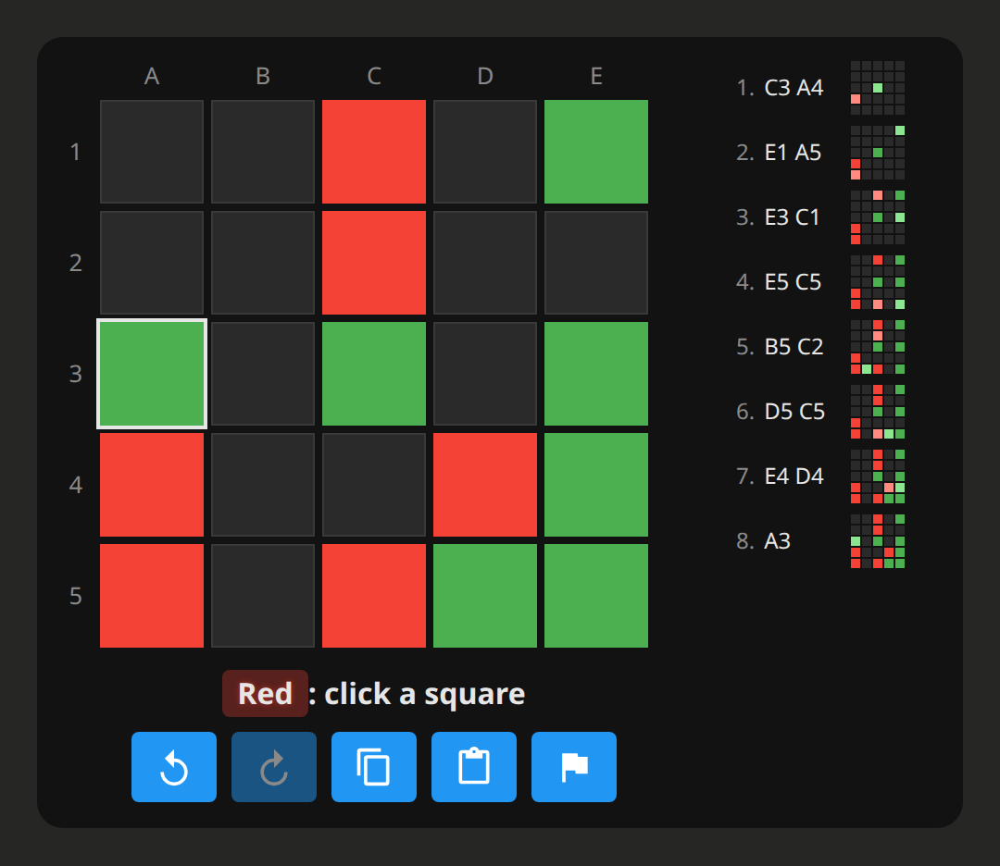

# Play Claude

The Complete the Square connector lets you play the game against Claude, on a board in the
chat. Claude chooses its own moves, and the server checks every move against the rules. It
needs no account and no sign-in.

You can also [play on the website](https://guppy16.github.io/CompleteTheSquare/), against
its engine or a friend, and read [how the engine works](https://guppy16.github.io/CompleteTheSquare/docs/).

## Set it up

1. In Claude, open **Settings → Connectors** and choose **Add custom connector**.
2. Name it Complete the Square and give the URL `https://cts.guppy16.workers.dev/mcp`.
3. Optional: in the connector's settings, set the tools to **Always allow**, so a game runs
   without a prompt before each move.

Then, in a new chat, ask: *"Let's play Complete the Square. You're Green."*

## How a game goes

- Claude starts a game and a board appears in the chat. Click a square to play your move;
  Claude replies on the same board, without you sending a message.
- The board shows the move list with a small board after each move, and has buttons to take
  back a move, put it back, copy the moves, paste a game to play on from, and resign (click
  twice).
- If you leave the board for 20 minutes, Claude stops waiting. Send it a message, like
  "your move", and the game carries on where it was.
- A game you leave is kept for a week after its last move. After that, Claude can start it
  again from its moves.

## The rules

A 5x5 board; Green moves first and the players take turns placing a piece on an empty square.
A piece captures any line of opponent pieces it closes off with another of yours, in all 8
directions. The first to own the four corners of a square (2x2 up to 5x5) wins; the same
position for the third time is a draw. The full rules, with pictures:
[The game](https://guppy16.github.io/CompleteTheSquare/docs/00-the-game).

## The tools

| tool | what it does |
|------|--------------|
| `new_game` | starts a game and shows the board; Claude chooses its colour, and can resume a game from its moves |
| `play` | plays Claude's move |
| `wait_for_move` | waits a few minutes for your click on the board, and returns your move |
| `user_move` | plays your move; the board calls it when you click, or Claude when you name a move in the chat |
| `report_bug` | sends a bug report to the developer, when you ask Claude to or a tool fails |

The board also uses tools of its own, which Claude doesn't see: `undo`, `redo`, `resign`,
`load_moves` and `game_state`.

## Privacy and support

The server keeps the moves of each game and the bug reports, and nothing that identifies
you: see the [privacy policy](https://guppy16.github.io/CompleteTheSquare/privacy).

To report a problem, ask Claude to report it, or open an issue at
[github.com/Guppy16/CompleteTheSquare/issues](https://github.com/Guppy16/CompleteTheSquare/issues).
