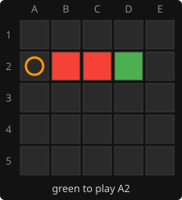
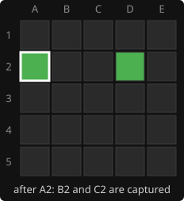

# 0. The game

The rules, and what each one asks of the engine.

## The rules

- A 5x5 board, empty at the start. Green and Red take turns placing one piece on an
  empty square; Green moves first.
- **Capture:** after placing a piece, look along each of the 8 directions. A run of one
  or more opponent pieces that ends at one of your own pieces is removed.
- **Win:** own all four corners of a square: 2x2 up to 5x5, sides along the rows and
  columns. There are 30 such squares.
- **Draw:** the same position for the third time.

Red has B2 and C2, Green has D2 and plays A2. Both red pieces sit between green ones, so
both are removed:

 

Only the player who moves captures. Placing a piece between two enemy pieces is safe.

## What the rules ask of the engine

- **The board is small.** 25 squares fit in one integer per player, and every rule
  becomes a few bit operations: [bitboards](01-bitboards.md),
  [move generation](02-move-generation.md).
- **The geometry is fixed.** The 8 rays from each square and the 30 squares are the
  same every game, so they are computed once: [captures and wins](03-captures-and-wins.md).
- **A win ends the game at once.** A single move can turn an even position into a lost
  one, so the engine must look ahead: [negamax](05-negamax.md),
  [alpha-beta](06-alpha-beta.md), [move ordering](07-move-ordering.md).
- **Captures swing the material.** Stopping the search in the middle of an exchange gives
  a wrong picture of the position: [evaluation](04-evaluation.md),
  [quiescence](08-quiescence.md).
- **Captured squares can be played again.** Positions recur, so the search must
  recognise them, and the game needs the draw rule: [repetition](12-repetition.md).
  The same positions are reached by different move orders:
  [transposition table](09-transposition-table.md).
- **The board looks the same rotated or reflected.** Eight board symmetries, times two
  for swapping the colours, give sixteen positions with one value:
  [symmetry](10-symmetry.md).
- **Green moves first, and the first move matters.** The corner A1 is a forced win; the
  replies to every first move are computed offline: [opening book](14-opening-book.md).
- **The game runs on a phone.** Each move gets a fixed amount of work, not a fixed depth:
  [iterative deepening and the node budget](11-iterative-deepening.md).

---

← [index](README.md) · [1. Bitboards](01-bitboards.md) →
